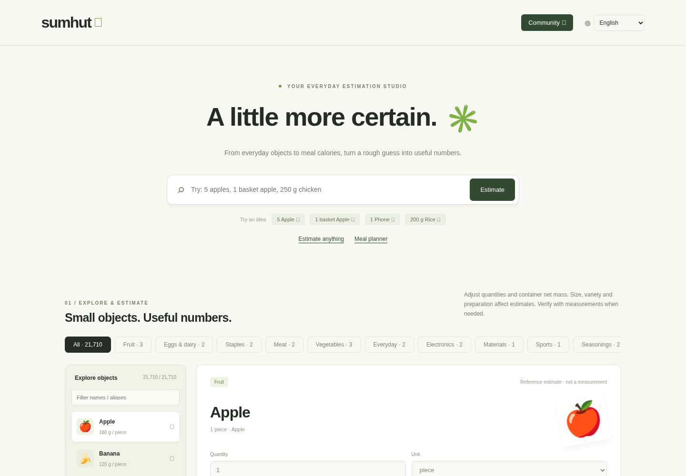
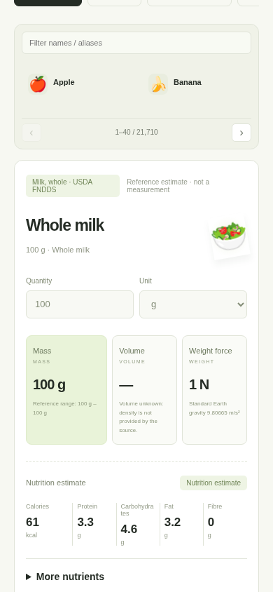

[English](README.md) · [Español](README.es.md) · [Português](README.pt.md) · [简体中文](README.zh-CN.md) · [繁體中文](README.zh-TW.md)

# sumhut — 所有物体与食物估算，让生活中的数字更清楚。

按数量、质量和来源份量，估算物体质量、重力、体积以及食物营养。

[sumhut.com](https://sumhut.com/) · [Community](https://sumhut.com/community)

## 可以做什么

- 搜索物体或食物，例如“5 苹果”“200 g 米饭”。
- 调整个数、克、千克、容器净质量及可用的 USDA 官方份量。
- 查看质量、已知密度对应的体积，以及单位为牛顿的重力。
- 查看热量、蛋白质、碳水化合物、脂肪、膳食纤维；详细 USDA 记录还提供已收录的维生素和矿物质。
- 组合多个物品，汇总结果、导出 CSV、分享计算链接。
- 在讨论区发布图片和视频，使用账号私信功能。
- 将 sumhut 添加到 iPhone 主屏幕，使用独立图标打开。

## 数据与精度

截至 2026 年 10 月，目录包含 21,710 条记录：20 条原始参考、8,789 条 USDA SR28 食品、469 条 Foundation、5,432 条 FNDDS，以及 7,000 条非食品估算。非食品包含材料和几何参数示例，并非全部是实测商品。缺失营养值表示未知，不代表零。大小、做法、材料和密度都会影响结果；需要准确值时请核对标签或实测。

## 语言

宣传文档提供上方所列五种语言。网站默认英语，界面支持 30 种语言；翻译不可用时，部分 USDA 原始名称可能仍显示英文。

## 关于此仓库

这是 sumhut 的公开产品介绍、使用示例与反馈资料库，不包含应用源码或部署配置。

[Examples](examples.md) · [Data sources](data-sources.md) · [FAQ](faq.md) · [LLM guide](llms.txt) · [Contributing](CONTRIBUTING.md)

